# Portfolio Risk Lab

A market data warehouse on PostgreSQL with a portfolio risk engine, bootstrap uncertainty estimates, a walk forward ML experiment and a Streamlit dashboard on top. Everything from raw Yahoo Finance prices to the charts in this README is produced by code in this repository and read back from the database.

The project is built around three questions:

1. How do you store market data so that every number can be traced back and reproduced?
2. How large is the one day loss of a portfolio, and how much can you trust that estimate?
3. Can a simple model predict the next volatility regime better than a trivial baseline?

The third question has a negative answer, and the README says so plainly in the [ML section](#volatility-regime-model).

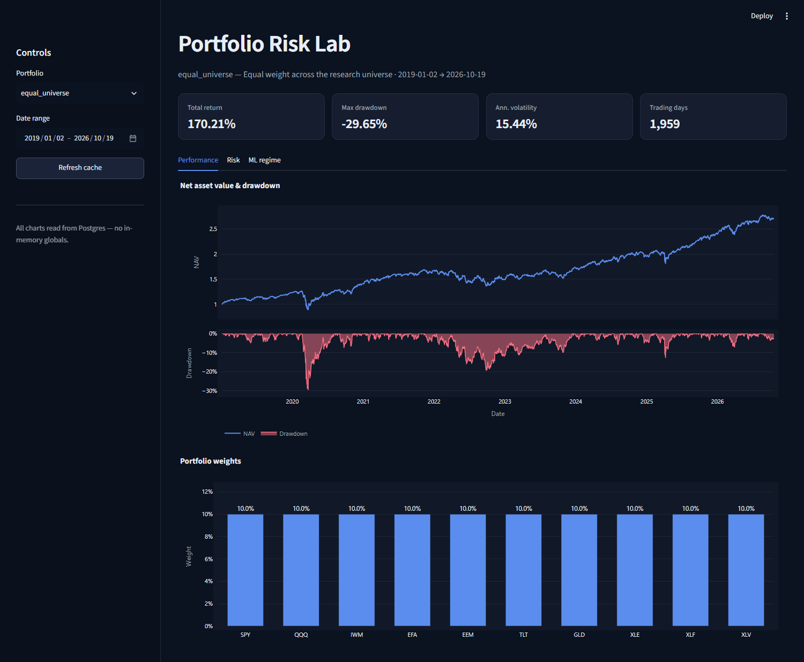

## Contents

- [Results at a glance](#results-at-a-glance)
- [Architecture](#architecture)
- [Data](#data)
- [Warehouse schema](#warehouse-schema)
- [Risk engine](#risk-engine)
- [Uncertainty of VaR](#uncertainty-of-var)
- [Backtest](#backtest)
- [Volatility regime model](#volatility-regime-model)
- [Dashboard](#dashboard)
- [Running it](#running-it)
- [Repository layout](#repository-layout)
- [Design decisions](#design-decisions)
- [Limitations](#limitations)

## Results at a glance

Ten liquid ETFs, daily data from 2019-01-02 to 2026-10-19, 1,959 daily returns per instrument.

| Portfolio | Total return | CAGR | Ann. volatility | Sharpe (rf = 0) | Max drawdown |
|---|---|---|---|---|---|
| equal_universe | 170.2% | 13.6% | 15.4% | 0.91 | -29.7% |
| manual_tilt | 212.4% | 15.8% | 16.9% | 0.95 | -31.6% |
| SPY buy and hold | 243.3% | 17.2% | 19.2% | 0.92 | -33.7% |

One day risk at 95% confidence over the full sample:

| Portfolio | Method | VaR | ES |
|---|---|---|---|
| equal_universe | Historical | 1.36% | 2.26% |
| equal_universe | Parametric (Gaussian) | 1.54% | 1.95% |
| equal_universe | Monte Carlo (50,000 paths) | 1.52% | 1.94% |
| manual_tilt | Historical | 1.48% | 2.51% |
| manual_tilt | Parametric (Gaussian) | 1.69% | 2.14% |
| manual_tilt | Monte Carlo (50,000 paths) | 1.67% | 2.12% |

Other headline numbers:

- The block bootstrap 95% interval for the historical VaR of equal_universe is 1.21% to 1.50%, around a point estimate of 1.36%.
- A rolling 250 day historical VaR backtest produced 94 exceptions in 1,709 days, a 5.50% hit ratio against the 5.00% expected. The Kupiec test does not reject the model (p = 0.35).
- The volatility regime classifier reaches an out of sample ROC AUC of 0.684, which is exactly what the persistence baseline reaches. It adds nothing over simply ranking current volatility.
- The test suite has 36 tests, all passing.

The performance numbers are in sample, before costs, with constant weights rebalanced daily. SPY beat both portfolios over this window, which is a fact about the period and the universe, not a conclusion about strategy quality.

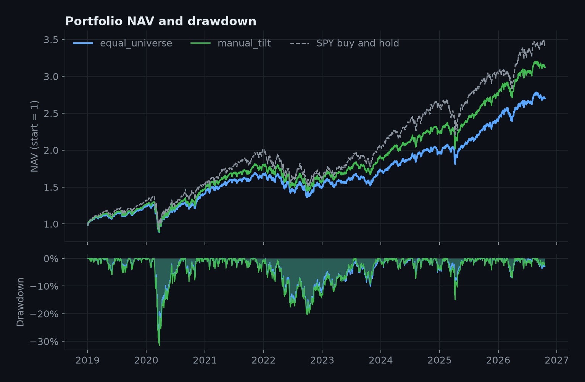

## Architecture

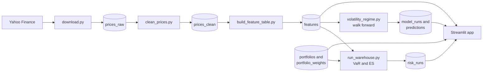

Every stage reads from and writes to PostgreSQL. No stage passes data to the next one through memory or files, which means each stage can be rerun on its own and the dashboard needs no precomputed artifacts.

## Data

| Ticker | Instrument | Role |
|---|---|---|
| SPY | S&P 500 | US large cap, benchmark for beta |
| QQQ | Nasdaq 100 | US growth and technology |
| IWM | Russell 2000 | US small cap |
| EFA | MSCI EAFE | Developed markets ex US |
| EEM | MSCI Emerging Markets | Emerging markets |
| TLT | US Treasuries 20+ years | Long duration bonds |
| GLD | Gold | Commodity |
| XLE | Energy sector | US sector |
| XLF | Financials sector | US sector |
| XLV | Health care sector | US sector |

Prices come from `yfinance` with `auto_adjust=False`, so the warehouse keeps both `close` and `adj_close`. Returns are computed from the adjusted close.

Cleaning rules, implemented in `src/etl/clean_prices.py`:

- Rows without an adjusted close are dropped. Nothing is forward filled.
- Days with an absolute simple return above 25% are flagged `outlier_return` and kept. No day in this universe was flagged.
- Tickers are mapped to a surrogate `instrument_id`, and all downstream tables join on that key.

After the load, `prices_raw` and `prices_clean` both hold 19,600 rows, exactly 1,960 per instrument with identical date ranges, and the `features` table holds one row per instrument and day.

Correlations show what you would expect. Equity ETFs move together, mostly with correlations between 0.60 and 0.93, and energy is the weakest link at 0.37 to 0.66. TLT is slightly negative against equities and GLD is close to uncorrelated. That is why an equal weight portfolio of ten ETFs still carries most of the equity risk.

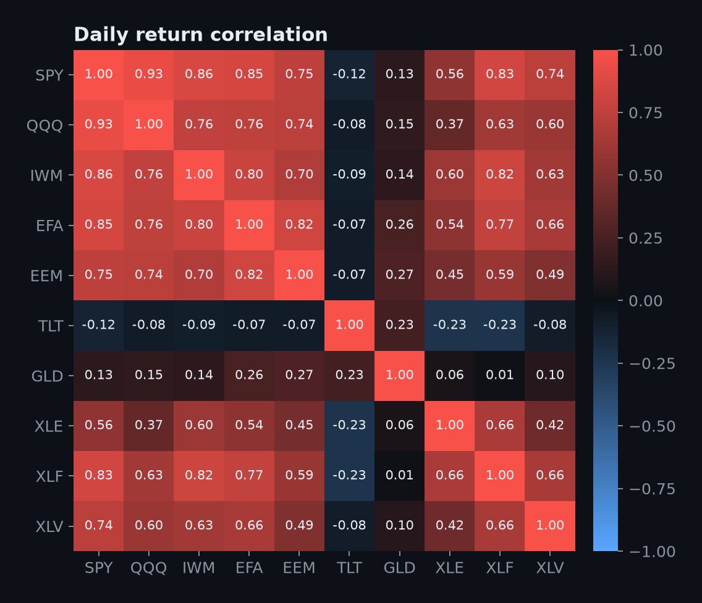

## Warehouse schema

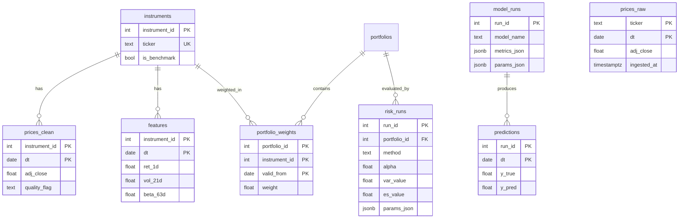

The full DDL is in [`sql/001_schema.sql`](sql/001_schema.sql). Two table families deserve a note:

- `prices_raw` and `prices_clean` are separate on purpose. Raw keeps what the vendor sent, clean is the research layer with an explicit quality flag.
- `risk_runs` and `model_runs` are append only experiment logs. Each row stores the method, the parameters as JSON, the window and the result, so a number on the dashboard always points to the run that produced it.

All writes are idempotent upserts on the primary key, so the pipeline can be rerun without creating duplicates.

## Risk engine

Daily simple returns and portfolio losses:

$$R_t = \frac{P_t}{P_{t-1}} - 1, \qquad L_t = -w^\top R_t$$

`alpha` is always the confidence level, so `alpha = 0.95` means 95% VaR. Three estimators are implemented, each with the same inputs and the same loss convention.

**Historical.** Empirical quantile and tail mean of the loss sample:

$$\mathrm{VaR}_\alpha = Q_\alpha(L), \qquad \mathrm{ES}_\alpha = \mathbb{E}\left[L \mid L \ge \mathrm{VaR}_\alpha\right]$$

**Parametric.** Gaussian portfolio with mean $\mu_p = w^\top \mu$ and variance $\sigma_p^2 = w^\top \Sigma w$:

$$\mathrm{VaR}_\alpha = -\mu_p + \sigma_p\, z_\alpha, \qquad \mathrm{ES}_\alpha = -\mu_p + \sigma_p \frac{\varphi(z_\alpha)}{1-\alpha}$$

**Monte Carlo.** Draw 50,000 return vectors from $\mathcal{N}(\mu, \Sigma)$ with a fixed seed, form portfolio losses, and take the empirical VaR and ES of the simulated losses.

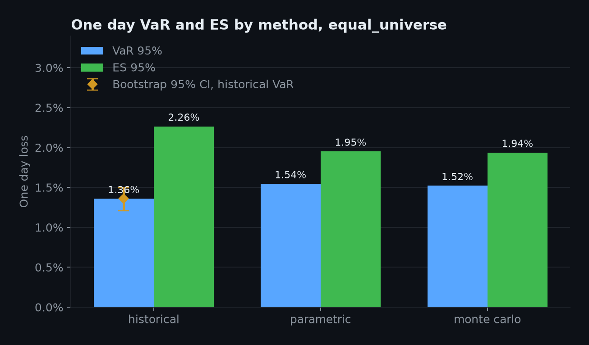

What the numbers say:

- Parametric and Monte Carlo agree to within 0.03 percentage points. They share the same Gaussian assumption, so this checks the implementation rather than adding information.
- Historical VaR is lower than the Gaussian VaR, but historical ES is higher than the Gaussian ES. Real returns have a narrower center and a heavier tail than a normal distribution, so the normal model overstates the 95% quantile and understates the average loss beyond it. The gap is 0.31 percentage points of ES for equal_universe.
- The manual tilt carries more risk than the equal weight portfolio on every measure, which follows from its 20% weight in QQQ and its low weight in TLT.

A parallel shock scenario applies the same return to every asset. A shock of -10% gives a 10% portfolio loss for any long only portfolio that sums to one. Doubling all volatilities doubles the Gaussian VaR to 3.15% for equal_universe and 3.45% for manual_tilt. Both are in `src/risk/stress.py`.

## Uncertainty of VaR

A single VaR number hides how noisy the estimate is. The tail of the loss distribution is estimated from few observations, so the quantile moves a lot between samples.

`src/stats/bootstrap.py` implements a non overlapping block bootstrap. The loss series is cut into blocks of 10 consecutive days, blocks are resampled with replacement, and the statistic is recomputed on each resample. Resampling blocks instead of single days keeps short range dependence such as volatility clustering inside each draw, which an i.i.d. bootstrap would destroy.

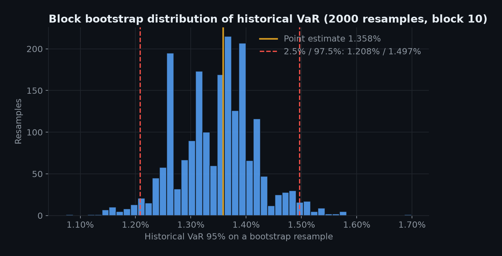

With 2,000 resamples the 95% percentile interval for the historical VaR of equal_universe is 1.21% to 1.50%. That is a relative width of about 21% around the point estimate. The dashboard uses 500 resamples to stay fast, so it shows a slightly different interval of 1.19% to 1.49%.

The histogram has visible spikes because the historical quantile can only take values that appear in the data. A smoothed or parametric bootstrap would give a smoother distribution.

## Backtest

A VaR model should be exceeded on about 5% of days at 95% confidence. The backtest uses a rolling window of 250 days, forecasts the next day's VaR, and counts exceptions. The Kupiec proportion of failures test checks whether the observed exception rate is consistent with 5%.

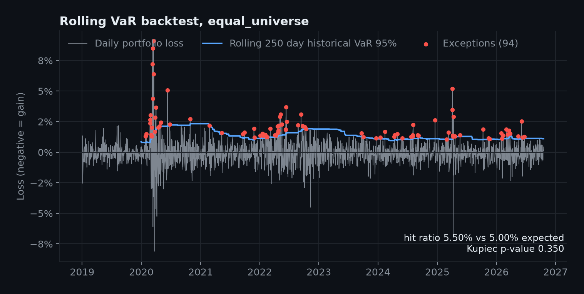

| Portfolio | Days tested | Exceptions | Hit ratio | Kupiec p-value | Rejected at 5% |
|---|---|---|---|---|---|
| equal_universe | 1,709 | 94 | 5.50% | 0.350 | No |
| manual_tilt | 1,709 | 91 | 5.32% | 0.542 | No |

The frequency of exceptions is acceptable, but the chart shows they are not evenly spread. They cluster in March 2020 and during 2022. The Kupiec test only looks at the count and is blind to this clustering, so passing it does not mean the model handles volatility spikes well. A conditional coverage test such as Christoffersen's would be the next step.

## Volatility regime model

**Task.** For SPY, predict whether realized volatility over the next 21 trading days will be high. The label is 1 when the forward 21 day standard deviation of returns is above the 70th percentile of its distribution, which gives a positive rate of 31%.

**Features.** Eleven features, each computed from data available on the prediction date: trailing volatility over 5, 21 and 63 days, the ratio of 21 to 63 day volatility, a 5 day volatility change and lag, absolute and squared return averages, the last return and its absolute value, and the 63 day beta.

**Validation.** Expanding window walk forward with 5 folds. A purge gap of 21 days separates the end of each training set from the start of its test fold, so no training label overlaps test features. There is no random shuffling anywhere. The model is a standardized logistic regression with class weights.

**Baseline.** Volatility persistence: the current 21 day volatility ranked against the training window. This ignores everything except how volatile the market is today, and it is a strong baseline because volatility is persistent.

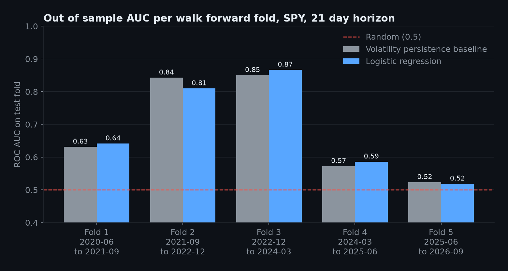

| Setup | Baseline AUC | Model AUC | Difference |
|---|---|---|---|
| Logistic regression, 21 day horizon | 0.684 | 0.684 | +0.000 |
| Gradient boosting, 21 day horizon | 0.684 | 0.562 | -0.122 |
| Logistic regression, 42 day horizon | 0.758 | 0.723 | -0.035 |
| Gradient boosting, 42 day horizon | 0.758 | 0.739 | -0.019 |

Average precision for the main setup is 0.404 for the model and 0.390 for the baseline, against 0.31 for a random classifier.

The honest reading:

- The model does not beat persistence. Mean AUC is identical, and the per fold results go in both directions.
- Both approaches work in folds 2 and 3, which contain the 2022 bear market, and are weak in fold 4 and close to random in fold 5. Volatility regimes are predictable when they are persistent and hard to call when they flip.
- A longer horizon raises the AUC of every method including the baseline, because the task becomes easier. Raw AUC across horizons is not comparable. Only the difference to the baseline is.
- The sample is small. There are 1,876 labeled days, but 21 day labels overlap heavily, so the number of independent observations is closer to 90. Differences of a few hundredths in AUC are within noise.

An earlier version of this project compared the model to a baseline that output a hard 0 or 1 from a volatility threshold. That baseline scored 0.59 AUC, which made the model look about 0.09 better. The comparison was unfair because a binary score throws away the ranking information, and it was replaced with the persistence baseline above.

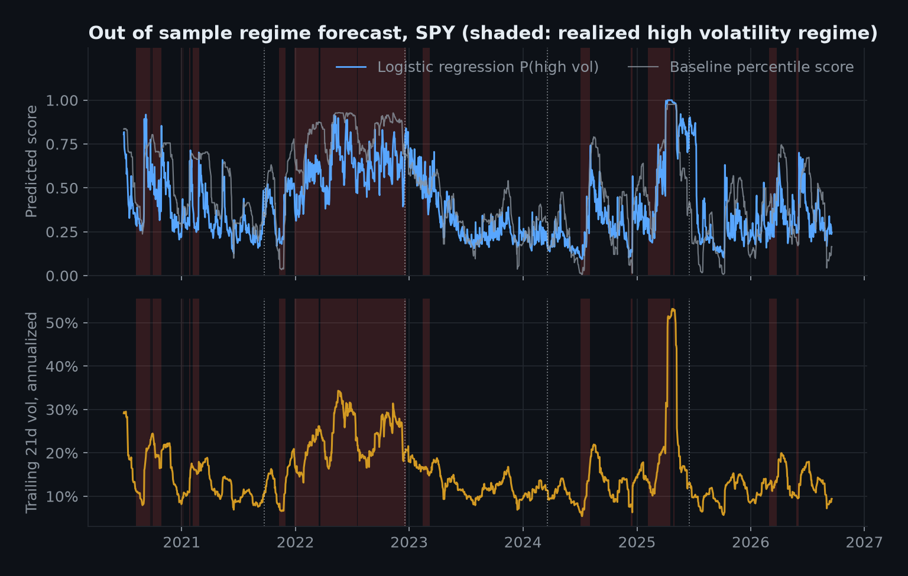

The coefficients of the logistic regression, fit on all data purely for interpretation, put most weight on recent squared returns and the volatility level. The beta feature has zero weight because the instrument is SPY and its beta against SPY is a constant 1.

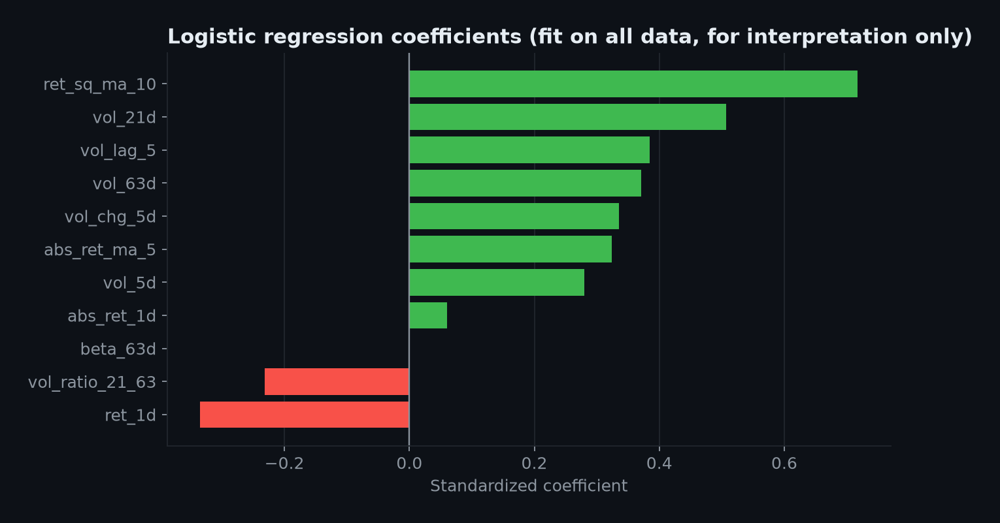

## Dashboard

The Streamlit app reads everything from PostgreSQL, uses a dark theme and has three tabs. A sidebar selects the portfolio and the date range, and a refresh button clears the cache.

**Performance.** KPI cards for return, drawdown, volatility and sample size, the NAV and drawdown chart, and the portfolio weights.

**Risk.** The correlation matrix, VaR and ES by method with the bootstrap interval overlaid on the historical VaR, and a table of the stored runs. If a portfolio has no stored `risk_runs`, the app computes the three methods live for the selected window and says so.

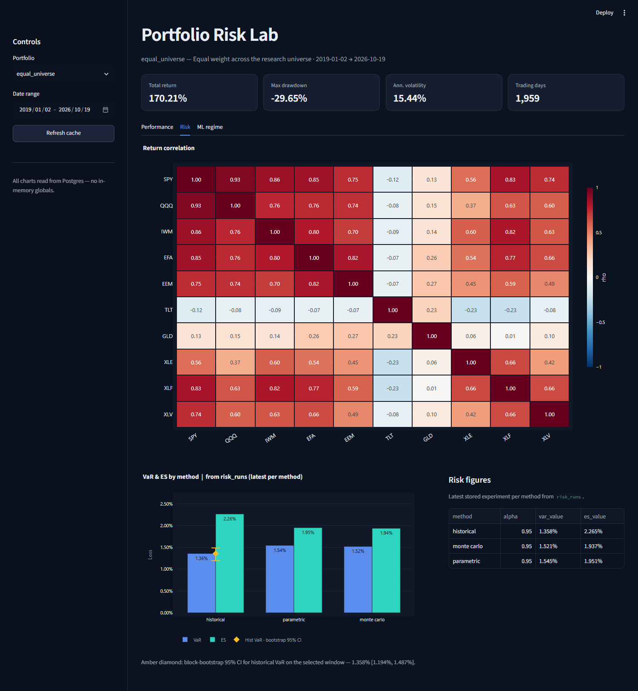

**ML regime.** Pick any stored model run and see its AUC, average precision and lift over the baseline, the out of sample score against the true regime, and the run parameters as JSON.

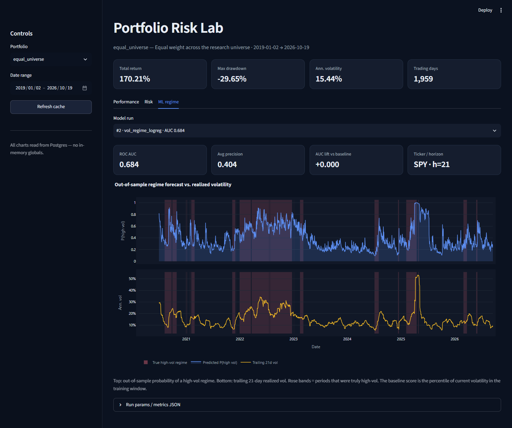

## Running it

Requirements: Python 3.12, Docker, and internet access for the initial download.

```bash
python -m venv .venv
source .venv/bin/activate        # Windows: .\.venv\Scripts\Activate.ps1
pip install -r requirements.txt
pip install -e .
cp .env.example .env             # Windows: copy .env.example .env
docker compose up -d
```

Run the whole pipeline, then open the dashboard:

```bash
python scripts/run_all_demo.py
streamlit run app/streamlit_app.py
```

Or run the steps one at a time:

```bash
python scripts/init_db.py          # apply the schema
python scripts/run_etl.py          # download, load prices_raw, build prices_clean
python scripts/run_features.py     # returns, volatility and beta
python scripts/run_portfolios.py   # seed equal_universe and manual_tilt
python scripts/run_risk.py         # VaR and ES, stored in risk_runs
python scripts/run_ml.py           # baseline and model, stored in model_runs and predictions
```

Tests and figures:

```bash
python -m pytest -q                # 36 tests, a few need the database and one downloads from Yahoo
python scripts/make_figures.py     # regenerates every chart in docs/img from the database
```

`risk_runs`, `model_runs` and `predictions` are append only logs, so rerunning the risk or ML scripts adds new runs instead of replacing old ones. The dashboard always shows the newest run per method.

The database is configured through `DATABASE_URL` and `RANDOM_SEED` in `.env`. Stop the database with `docker compose down`, or add `-v` to delete the data volume.

## Repository layout

```text
app/streamlit_app.py       Dashboard entry point
docs/img/                  Figures used in this README
scripts/                   One command line entry point per pipeline stage
sql/001_schema.sql         Database schema
src/config.py              Settings from the environment
src/db/                    SQLAlchemy engine
src/etl/                   Download, staging into prices_raw, cleaning into prices_clean
src/features/              Returns, rolling volatility and beta, feature table
src/portfolio/             Weights, portfolio returns, seeding portfolios into the database
src/risk/                  Historical, parametric and Monte Carlo VaR and ES, backtest, stress, warehouse runner
src/stats/bootstrap.py     Block bootstrap confidence intervals
src/ml/                    Labels, purged splits, metrics, volatility regime model
src/viz/                   Database queries and Plotly figures for the dashboard
tests/                     Unit and integration tests
```

The VaR, ES, Monte Carlo, Kupiec and stress code was first written for a standalone project, [Market-Risk-Engine](https://github.com/domanskis06/Market-Risk-Engine), and ported here so it could run on warehouse data.

## Design decisions

- **PostgreSQL as the single source of truth.** Stages communicate through tables, which makes each one independently testable and rerunnable.
- **Idempotent upserts.** Every load uses `INSERT ... ON CONFLICT DO UPDATE`, so a failed run can simply be repeated.
- **Surrogate instrument keys.** Tickers are renamed and reused over time, an integer key is stable.
- **Experiments as rows.** A VaR number or an AUC is never a bare float. It is a row with parameters, window and timestamp.
- **Time aware validation.** Walk forward folds with a purge gap, because random cross validation leaks information on overlapping time series labels.
- **One loss convention.** Losses are $L = -R_p$ and `alpha` is a confidence level everywhere, which removes a common source of sign and tail mistakes.
- **Fixed seeds.** Monte Carlo, bootstrap and model training use `RANDOM_SEED`, so reruns reproduce the same numbers.

## Limitations

- **Small universe and survivorship.** Ten large ETFs that exist today. Results say nothing about single stocks or delisted assets.
- **Data vintage.** `yfinance` returns adjusted prices as of the download date, and re-ingesting overwrites `prices_raw`. The warehouse does not keep historical vendor snapshots, so it is not a true point in time store. Features themselves only use data up to each date.
- **Full sample estimates.** The risk table in this README uses the whole 2019 to 2026 sample, which includes March 2020. The mean and covariance used by the parametric and Monte Carlo methods are in sample estimates.
- **Gaussian assumptions.** Parametric and Monte Carlo VaR assume normal returns and constant covariance. Monte Carlo here adds no tail information beyond the parametric method. A Student t or filtered historical simulation would.
- **Backtest scope.** Only the historical method is backtested, with a single window length, and the Kupiec test ignores exception clustering.
- **Label definition.** The 70th percentile threshold for the high volatility label is computed on the full sample, including test periods. It defines the target only and does not enter the features, but a strict setup would estimate it inside each training fold.
- **ML evidence is weak.** One instrument, overlapping labels, about 90 independent observations and no improvement over the baseline. The experiment is a clean validation setup, not a trading signal.
- **No costs, taxes or slippage.** Portfolio returns assume constant weights rebalanced every day at no cost.
- **Single user setup.** The database credentials in `docker-compose.yml` are for local development only.
